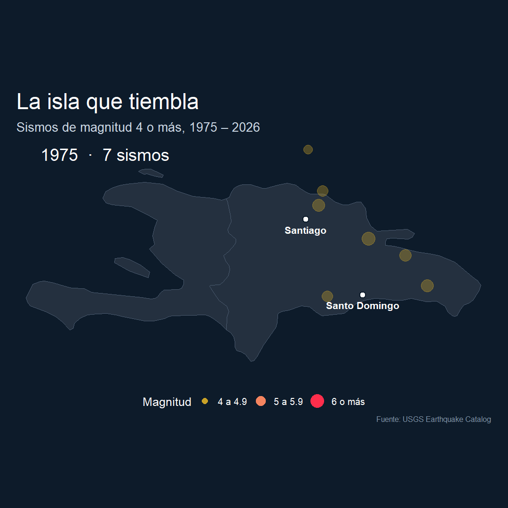
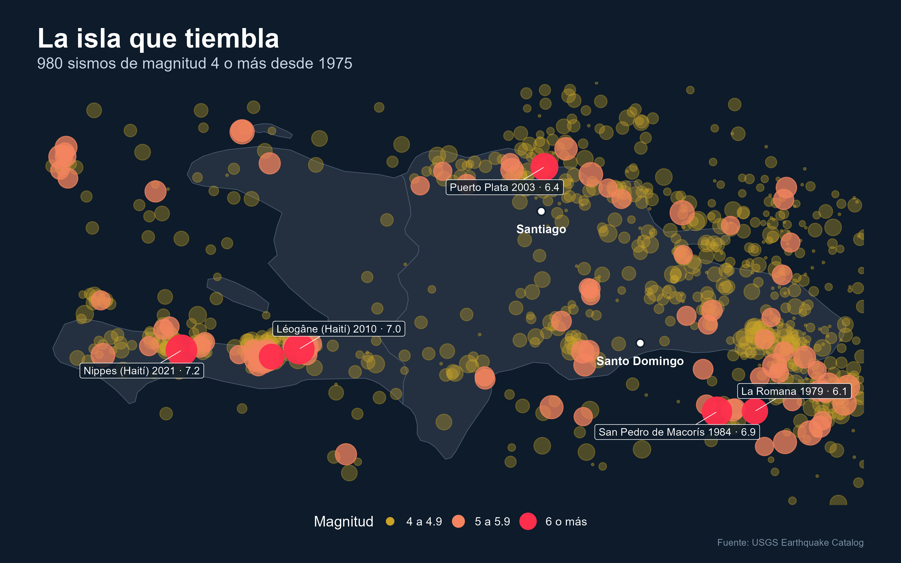

# La isla que tiembla

¿Cuánto tiembla realmente en La Española? Este proyecto reúne todos los sismos de magnitud 4 o más registrados en la isla desde 1975 y los muestra en un mapa y una animación año por año.



## Lo que muestran los datos

- **980 sismos** de magnitud 4 o más desde 1975.
- **93** de magnitud 5 o más, y **6** de magnitud 6 o más.
- **48%** ocurrió en el mar.
- **180** ocurrieron a menos de 100 km de Santo Domingo, y otros 180 a menos de 100 km de Santiago.
- Los más fuertes: Haití 2021 (7.2), Haití 2010 (7.0) y uno de 6.9 frente a San Pedro de Macorís en 1984.



## Cómo replicarlo

Instala los paquetes:

```r
install.packages(c(
  "readr", "dplyr", "tidyr", "lubridate", "ggplot2", "ggrepel", "sf",
  "rnaturalearth", "rnaturalearthdata", "scales", "gganimate", "gifski", "av"
))
```

Luego corre `sismos_isla.R`. El script:

1. Usa `sismos_usgs_raw.csv` si está en la carpeta; si no, descarga los datos actualizados del USGS.
2. Imprime en consola las cifras clave.
3. Guarda el mapa (`mapa_sismos_isla.png`) y la animación en GIF y MP4.

Puedes cambiar el año de inicio, la magnitud mínima o la zona en la sección `Parámetros` del script.

## Archivos

| Archivo | Contenido |
|---|---|
| `sismos_isla.R` | Script completo: datos, cifras, mapa y animación |
| `sismos_usgs_raw.csv` | Datos descargados del USGS (octubre 2026) |
| `mapa_sismos_isla.png` | Mapa estático con los sismos más fuertes señalados |
| `sismos_isla.gif` | Animación año por año |

## A tener en cuenta

- **Hoy se registran más sismos que antes, pero no porque tiemble más.** Los instrumentos han mejorado y ahora detectan sismos que antes pasaban sin registrar. Por eso no se debe leer el aumento por década como más actividad.
- Se incluye Haití porque la isla comparte las mismas fallas.
- El mapa muestra dónde ha temblado, no predice dónde temblará.

## Fuente

[USGS Earthquake Catalog](https://earthquake.usgs.gov/earthquakes/search/), Servicio Geológico de Estados Unidos. Datos de dominio público.

## Autor

Braylin Jiménez · [LinkedIn](https://www.linkedin.com/in/tu-perfil)
